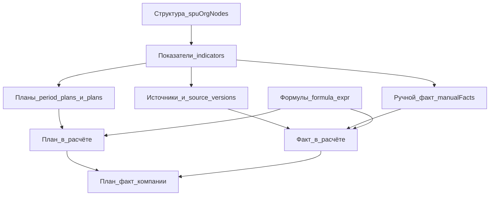

# Инструкция администратора по СПУ WorkTime

Документ для контроля настроек СПУ, диагностики пустых планов/фактов и понимания границ программы.  
Действия финансиста по заполнению описаны отдельно: [`docs/spu-finansist-instrukciya.md`](spu-finansist-instrukciya.md).

Основной код UI: `app.html`. Серверные срезы для денежных итогов Финконтроля: `server/wt_api.py` (`spu_fr_territory_revenue_by_day`, `handle_get_state`, `filter_state_payload`).

---

## 1. Архитектура разделов СПУ (простым языком)

| Раздел меню | Роль |
|---|---|
| **Структура СПУ** | Оргдерево (`spuOrgNodes`) + вкладки «Департаменты», «Источники (справочник)», **«Показатели СПУ»** |
| **Настройка показателей** | Классификация (итоговые / ключевые / не настроено / архив), **«Планы СПУ»**, настройка начала отчётной недели |
| **Ввод показателей** | Ручной ввод фактов (`manualFacts`) по узлам дерева за неделю |
| **План–факт компании** | Отчёт по двум неделям: план, факт, %, динамика |
| **Панель управления / Настройка панели** | Витрина; зависит от тех же показателей и планов |

Отдельного пункта меню «Показатели СПУ» нет — это вкладка внутри **Структура СПУ** (`renderSpuStructureHtml` / `setSpuStructureTab('indicators')`).

---

## 2. Связь сущностей

| Сущность | Где живёт | Смысл |
|---|---|---|
| Узел структуры | `management.spuOrgNodes` | Департамент / поддепартамент |
| Показатель | `management.indicators` | Контролируемая строка; стабильный `indicator_id` |
| Размещение | `target_org_node_id` + доп. узлы | Один показатель — одно значение; копии не создаются |
| Источники | в показателе + `source_versions` | Откуда факт (WorkTime, ручной и т.д.) |
| Формула факта | `formula_expr` (в версии) | Расчёт факта |
| Формула плана | `plan_formula_expr` + `plan_calc_mode` | Расчёт плана |
| План периода | `period_plans` → раскладка в `plans` | Управленческий период → недельные планы |
| Ручной факт | `manualFacts` | Ввод во «Ввод показателей» |
| Отчёт | `renderMgmtPlanFactHtml` | Читает план/факт через `mgmtPfRead` / `spuActiveConfig` |

Глоссарий для проверки настроек финансиста:

- **Показатель** ≠ **метрика WorkTime** (метрика — только источник факта).  
- **План** в «Планы СПУ» ≠ **дата начала действия источника**.  
- **Предыдущая неделя в формуле** ≠ **неделя начала действия изменений**.

---

## 3. Как проверять настройки финансиста

Чеклист администратора:

1. **Структура** — нужные узлы активны, показатель висит на правильном основном департаменте.  
2. Карточка показателя → тип, способ расчёта, галочка **«Показывать в План–факте»**.  
3. Для WorkTime: источники заполнены, метрика с участием в СПУ, результат чаще **«Итого метрики — все участники»** (`metric_overall`).  
4. Для расчётных: есть формула факта; если нужен автоплан — включён расчёт плана и заполнена формула плана.  
5. **Планы СПУ** — есть управленческий период, значение и тип (накопительный / целевое), план разложен на недели.  
6. **Ввод показателей** — ручные показатели заполнены за нужную неделю.  
7. **План–факт** — строка есть; план/факт ожидаемые; «—» осознанны.

При редактировании `saveSpuOrgIndicator` сохраняет тот же `indicator_id` — история планов/фактов/версий не должна «обнуляться» только из‑за переименования.

---

## 4. Даты начала действия и версии

### 4.1. Что хранится

Настройки источников и формул версионируются в **`source_versions`**: сегменты с `effective_from` / `effective_to`, внутри — источники, `formula_expr`, `plan_formula_expr`, `plan_calc_mode` и др.

Ключевые функции:

| Функция | Назначение |
|---|---|
| `spuVersionAt(it, iso)` | Какая версия покрывает день |
| `spuActiveConfig(it)` | Конфиг «для текущего UI/ПФ» (якорь — конец текущего периода) |
| `spuCommitSourceVersion` | Запись новой версии с даты |
| `spuIndPropagateWorktimeSourcesToLater` | После сохранения WorkTime — источники на поздние версии |
| `spuIndPropagateSideToLater` / `spuIndAskLaterVersionsAction` | Поведение для формул при наличии более поздних версий |
| `spuFormulaVersionPlan` / `spuApplyFormulaVersionPlan` | План применения формулы (create / inplace / split_tail / …) |

### 4.2. UI-поля

- WorkTime: **«Неделя начала действия изменений»** (`renderSpuIndWorktimeSourceEffectiveBox`).  
- Формулы: **«Дата начала действия изменений»** (`renderSpuIndFormulaBox`).

Правило для контроля: недели **до** даты читают старую версию; с даты — новую. Открытие карточки само по себе версию не создаёт.

### 4.3. Отчётная неделя vs данные в формуле

- Колонки План–факта — отчётные недели (по умолчанию чт–ср; глобальная настройка начала недели есть в «Настройка показателей»).  
- Операнд формулы с **«предыдущая неделя»** сдвигает якорь на −7 дней (`week_offset: -1`, `spuFormulaOperandWeekFrom` / `mgmtRunInThuWeek`).  
- Версия источника для недели WorkTime выбирается с учётом учётного конца недели (`spuIndAccountingWeekEndIso` — ориентир на среду при чт–ср).

Глобальный ориентир старта отчётности в коде: константа вроде `SPU_REPORTING_START_ISO` (проверка в живой базе — **Требуется проверка в интерфейсе**).

---

## 5. Контроль сохранения

| Действие финансиста | Что должно произойти |
|---|---|
| Сохранить карточку показателя | `saveApp` / узкое сохранение management; ID показателя тот же |
| Сохранить WorkTime-источники | Commit версии + обязательный propagate на поздние версии + проверка, что mid записан |
| Сохранить формулу при поздних версиях | Запрос: применить ко всем / только до следующей / отмена (**Требуется проверка в интерфейсе** точных текстов prompt) |
| Сохранить планы | `saveSpuPlansTabRow` / `saveSpuPlansTabAll` → `period_plans` + недельные `plans` |
| Ввод факта | Запись в `manualFacts` за ключ периода |

Если после F5 пропали KPI/другие зоны — это зона SoftSync/OPS, не инструкция по СПУ-формулам; при повторяемости — к разработчику (см. таблицу проблем).

---

## 6. Проверка корректности расчётов

1. **План–факт** — две недели, фильтр по департаменту.  
2. Для формул — в карточке **«Проверить формулу за период (чт–ср)»** → **«Проверить формулу факта»** / плана (`spuIndFormulaCheckForPeriod`). Считает черновик, историю не пишет.  
3. Сравнить операнды в таблице проверки с исходными показателями в ПФ за ту же и предыдущую неделю.  
4. Для WorkTime overall — убедиться, что в исходных метриках дни недели заполнены (`mgmtCollectMetricOverallSeries`, `present`).  
5. Для денег Финконтроля — в состоянии клиента должен быть срез `spuFrTerritoryRevenueByDay` (см. §8).

---

## 7. Почему нет плана или факта

### Нет строки в План–факте

- Выключено **«Показывать в План–факте»** (`show_in_planfact`).  
- Показатель в архиве / неактивен.  
- Фильтр «Департамент» / «Ответственный» скрывает строку.

### План пустой («—»)

- Нет записи в «Планы СПУ» на управленческий период, покрывающий неделю.  
- Период неактивен или даты периода не захватывают четверг недели.  
- Для формульного плана: выключен `plan_calc_mode`, пустой `plan_formula_expr`, или операнды пусты.  
- Показатель ещё «до старта» (`reporting_from` / `spuActiveConfig` → inactive) — **Требуется проверка в интерфейсе** на конкретной карточке.

### Факт пустой («—»)

- Ручной: не введён во «Ввод показателей».  
- WorkTime: нет дней с данными; неверная метрика; версия источника ещё не действует.  
- Overall: `present === false` → неделя даёт `null`, не ноль.  
- Формула: любой операнд `null` или деление на ноль → итог `null` (`spuEvalFormula`, `spuSafeDiv`).  
- Деньги ФР: нет среза / нет направлений в `financeRec` за дни.

---

## 8. Диагностика WorkTime и Финконтроля

### Метрики магазина / склада (кассы, инвентаризация)

1. В карточке источника — правильная встроенная метрика (подписи picker через `spuWorkMetricPickerLabel`).  
2. В разделе метрик за дни недели есть значения (или явные нули).  
3. Режим результата — overall / совместимый legacy.  
4. ПФ: факт число или «—»; ноль отображается как число (`mgmtFormatValue` / `mgmtPfNumCell`).

### Денежные итоги Финконтроля

Источники пользовательских названий:

- «Деньги — итого ОПТ»  
- «Деньги — итого Розница/Склад»

Цепочка:

1. Сервер считает агрегат `spu_fr_territory_revenue_by_day` из `financeRec` (Территория, направления opt/retail/warehouse).  
2. Срез кладётся в payload как `spuFrTerritoryRevenueByDay` в `filter_state_payload` для пользователей с доступом к management.  
3. Для **администратора** срез дополнительно дописывается в `handle_get_state`, если ключа ещё нет (админ обходит filter через `strip_secrets`).  
4. Клиент в `mgmtCollectMetricOverallSeries` читает **только** этот срез (не сырой `financeRec`).

Диагностика пустого денежного факта у админа после публикации:

1. Обновление состояния / повторный вход (чтобы пришёл новый GET).  
2. Наличие поступлений Территории в Финконтроле за дни недели.  
3. Версия источника показателя покрывает неделю.  
4. Если у non-admin СПУ факт есть, а у админа нет на старой сборке — признак бага обхода filter (исправление — в `handle_get_state`).

Права: сотруднику СПУ без `financeRec` отдаётся только агрегат, не операции — так задумано.

---

## 9. Ноль vs отсутствие данных

| Отображение | Смысл | Типичная причина |
|---|---|---|
| **«—»**, класс пустой ячейки | Нет данных (`null`) | Пустая метрика, нет версии, формула без операнда, ÷0 |
| **0** / **0 ₽** | Есть данные, значение ноль | Явный ноль в источнике / сумме |
| Статус сравнения «Нет данных» | Недостаточно чисел для динамики/% | Один из периодов без pct |

В overall-серии: день без факта не добавляется; явный 0 добавляется и даёт `present: true`.

---

## 10. Формулы и исторические периоды

### Реализовано

- Отдельные формулы факта и плана.  
- Операции + − × ÷, скобки, константы.  
- Ссылки на план/факт другого показателя.  
- Операнды **текущей** и **предыдущей** недели (`ind_fact_0`, `ind_fact_m1`, `ind_plan_0`, `ind_plan_m1`).  
- Проверка за выбранную неделю чт–ср.  
- Версии с даты начала действия.

### Частично

- В evaluator теоретически уйдёт любой целый `week_offset`, но UI предлагает только 0 и −1 (`spuFormulaIndKindKey` сводит прочее к текущей).  
- Тип результата «Процент» — отображение с «%» **без** авто×100; отдельного оператора `%` нет.

### Не реализовано

- Несколько недель назад (−2, −3, …) в конструкторе.  
- Календарный месяц / квартал / произвольный диапазон дат как операнд формулы.  
- Полноценный «Из 1С».  
- Загрузка планов из Excel / Google Таблиц.

Проверка истории: выбрать в ПФ неделю до смены формулы/источника и после; значения должны соответствовать разным версиям `source_versions`.

---

## 11. Матрица возможностей

| Возможность | Статус | Как в интерфейсе | Код / ограничение |
|---|---|---|---|
| Дерево департаментов, ↑↓ | Работает | Структура СПУ | `spuOrg*`, `spuOrgMoveSibling` |
| Показатели, мульти-узел без копий | Работает | Карточка показателя | `spuSetIndicatorDisplayNodes` |
| Ручной / WorkTime / Расчётный | Работает | Тип показателя | `spuIndKind` |
| Из 1С | Не реализовано | Подпись «позже» | UI-заглушка |
| Несколько источников, сумма/среднее | Работает | Способ расчёта + источники | `spuIndAgg` |
| Итого метрики — все участники | Работает | Результат источника | `metric_overall` |
| Кассы / инвентаризация / деньги ФР | Работает | Встроенные метрики picker | overall + срез ФР |
| Формула факта/плана, +−×÷, скобки | Работает | Блок формулы | `spuEvalFormula` |
| Текущая и предыдущая неделя | Работает | Виды элемента формулы | `week_offset` 0 / −1 |
| −2 недели и далее | Нет в UI | — | Не предлагается |
| Месяц/квартал/диапазон в формуле | Нет | — | Не реализовано |
| Версии с даты | Работает | Дата/неделя начала действия | `source_versions` |
| Планы накопительный/целевой | Работает | Планы СПУ | `spuApplyPeriodPlanToWeeks` |
| Excel / Google планы | Нет | — | Не реализовано |
| Проверка формулы за неделю | Работает | Кнопки проверки | `spuIndFormulaCheckForPeriod` |
| Пусто vs 0 в ПФ | Работает | «—» vs число | `mgmtFormatValue` |
| Admin получает срез денег ФР | Работает после фикса GET | — | `handle_get_state` |

Легенда статусов: **работает** — подтверждено кодом (и частично автотестами); **частично** — есть задел без полной поддержки UI; **нет** — в продукте отсутствует.

---

## 12. Когда нужна помощь разработчика (Cursor)

Обращайтесь к разработке, если:

1. Настройки и исходные данные верны, но факт стабильно пуст после обновления состояния.  
2. У админа нет денежных фактов, а у сотрудника СПУ есть (или наоборот) — подозрение на GET/filter.  
3. После сохранения источника mid «пропадает» на следующих неделях.  
4. SoftSync/конфликт версий затирает показатели или KPI.  
5. Нужны периоды в формуле глубже «предыдущей недели», Excel, 1С, Google — это новая функция, не настройка.  
6. Синтаксическая ошибка входа / массовый DomainWriter-diff — зона серверного ядра, не СПУ-карточки.

---

## 13. Таблица диагностики

| Проблема | Возможная причина | Что проверить администратору | Когда к Cursor |
|---|---|---|---|
| Нет строки в План–факте | Выключен показ / архив / фильтр | Галочка «Показывать в План–факте», статус, фильтры ПФ | Если галочка есть, а строки нет после F5 |
| План «—» | Нет period plan / формула плана | «Планы СПУ», тип периода, недели внутри периода | Если план сохранён, а на всех неделях пусто |
| Факт «—» у ручного | Не введён факт | «Ввод показателей», неделя, статус «Не заполнено» | Редко |
| Факт «—» у WorkTime | Пустая метрика / дата версии | Исходные метрики за дни недели; неделя начала действия | Если метрика заполнена, а overall пуст |
| Факт 0, ожидали «нет данных» | Явные нули в источнике | Отличить 0 от «—»; дни с нулём | Только если 0 появился без ввода |
| Деньги ФР пустые у админа | Нет `spuFrTerritoryRevenueByDay` в GET | Версия сервера с допиской среза в `handle_get_state`; повторный вход | Если фикса нет или срез не появляется |
| Деньги ФР пустые у всех | Нет данных Территории / направления | Финконтроль: ИТОГО ОПТ / Розница / Склад за дни | Если структура FR не совпадает с helper |
| Формула «Нет данных» | Пустой операнд или ÷0 | «Проверить формулу…», таблица операндов | Если операнды в ПФ есть, а проверка пустая |
| Старая неделя «поехала» после смены | Неверная дата начала / propagate | `effective_from`, ПФ до/после даты | Если прошлые недели пересчитались вопреки версии |
| Нужен месяц в формуле | Функции нет | Объяснить ограничение UI | Запрос новой функции |
| Нужен Excel планов | Функции нет | Ввод через «Планы СПУ» | Запрос новой функции |
| 1С источник | «Позже» | Не использовать в проде | Реализация модуля |
| Пропали настройки после SoftSync | Конфликт/overwrite | Версии, кто сохранял параллельно | При повторяемой потере данных |
| Не вход в программу | SyntaxError / API | Не чинить СПУ-настройки | Немедленно к разработке |

---

## 14. Полезные точки кода (для сопровождения)

| Зона | Где смотреть |
|---|---|
| Меню / секции | `app.html` ~4846–4871, `sectionTitle` |
| Структура и показатели | `openSpuOrgNodeForm`, `openSpuOrgIndicatorForm`, `saveSpuOrgIndicator` |
| Источники / picker | `renderSpuIndSourcesBox`, `spuIndSrcMetricPickerHtml`, `spuWorkMetricPickerLabel` |
| Версии | `spuCommitSourceVersion`, `spuVersionAt`, `spuActiveConfig` |
| Формулы | `spuEvalFormula`, `spuFormulaIndKindLabel`, `spuIndFormulaCheckForPeriod` |
| Планы периода | `renderSpuPlansTabHtml`, `saveSpuPlansTabRow`, `spuApplyPeriodPlanToWeeks` |
| Ввод | `renderMgmtIndicatorInputHtml` |
| План–факт | `renderMgmtPlanFactHtml`, `mgmtPfRead`, `mgmtPfNumCell` |
| Overall факты | `mgmtCollectMetricOverallSeries`, `mgmtMetricFact` |
| Срез ФР | `server/wt_api.py`: `spu_fr_territory_revenue_by_day`, `filter_state_payload`, `handle_get_state` |
| Автотесты зоны | `server/test_wt_api.py` (`WtSpuFinrec*`), `server/wt_spu_*_harness.js` |

---

## 15. Что не делать администратору без согласования

- Менять формулы и источники «заодно» на проде без даты начала действия.  
- Поднимать лимиты SoftSync/OPS или отключать 409.  
- Править рабочую БД вручную.  
- Смешивать данные Магазина Володарского и Территории.  
- Считать обсуждавшиеся, но не сделанные функции (месяц в формуле, Excel) уже доступными.

При сомнении: сначала воспроизвести в План–факте и «Проверить формулу…», затем — таблица §13.
